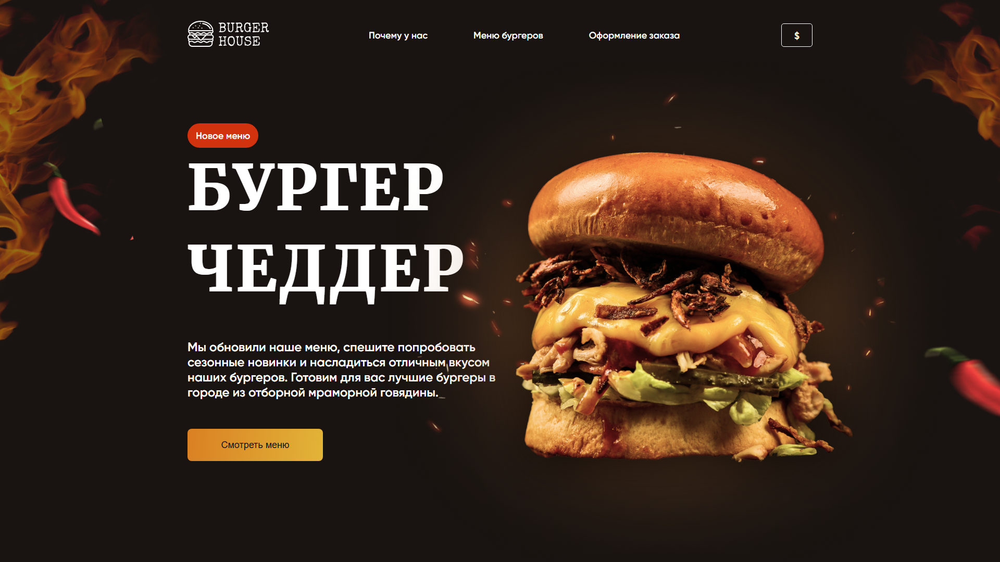
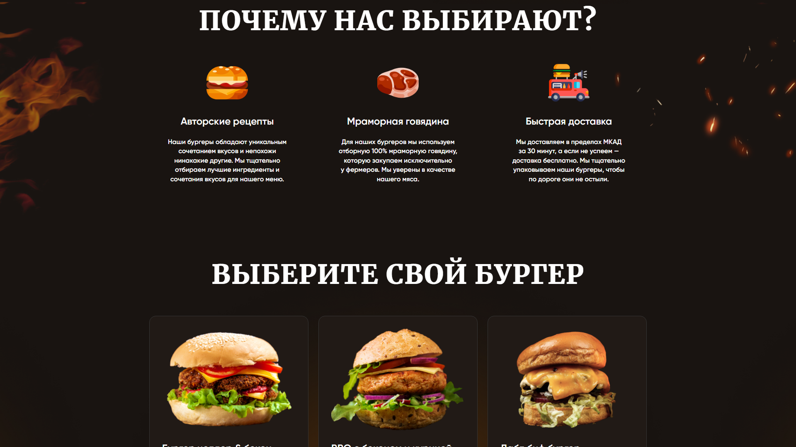
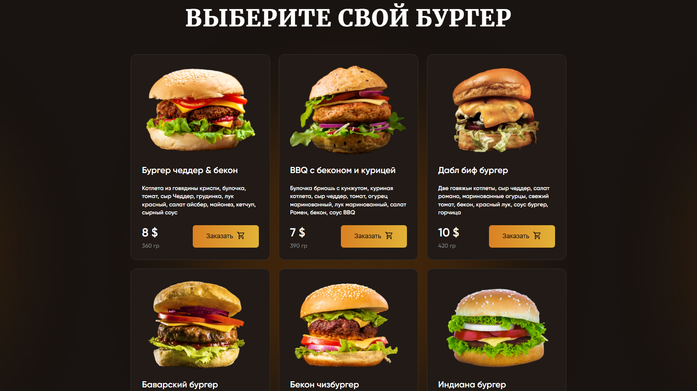
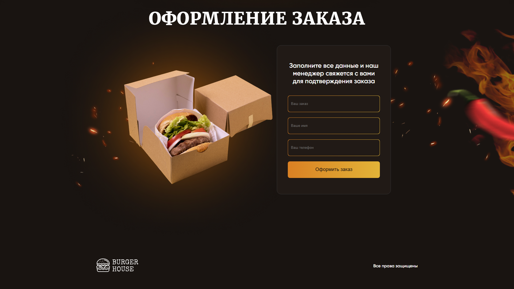

<p align="center">
  
</p>

<p align="center">
  <b>Лендинг бургерной «Бургер чеддер»: меню из 12 бургеров, переключение валюты и форма заказа с проверкой полей.</b>
</p>

<p align="center">
  
  
  
  <a href="https://dekciw.github.io/BurgerCheddar/"></a>
</p>

<p align="center">
  <a href="https://dekciw.github.io/BurgerCheddar/">
    
  </a>
</p>

<br>

<p align="center">
  
</p>

<br>

<table align="center">
  <tr>
    <th>&#8199;&#8199;&#8199;&#8199;&#8199;&#8199;Меню&#8199;&#8199;&#8199;&#8199;&#8199;&#8199;</th>
    <th>&#8199;&#8199;&#8199;&#8199;&#8199;&#8199;Заказ&#8199;&#8199;&#8199;&#8199;&#8199;&#8199;</th>
    <th>&#8199;&#8199;&#8199;&#8199;&#8199;&#8199;Интерфейс&#8199;&#8199;&#8199;&#8199;&#8199;&#8199;</th>
  </tr>
  <tr>
    <td valign="top">
      - 12 бургеров с составом<br>
      - Вес и цена на карточке<br>
      - Смена валюты в шапке<br>
      - $, ₽, BYN, € и ¥<br>
      - Блок «Почему нас выбирают»<br>
      - Кнопка «Заказать»
    </td>
    <td valign="top">
      - Поля бургера, имени, телефона<br>
      - Пустое поле подсвечивается<br>
      - Сообщение после заказа<br>
      - Поля очищаются сами<br>
      - Плавная прокрутка к форме<br>
      - Заказ без отправки на сервер
    </td>
    <td valign="top">
      - Тёмная тема с огнём<br>
      - Меню с якорями<br>
      - Плавная прокрутка<br>
      - Свой шрифт<br>
      - HTML, CSS и JavaScript<br>
      - Сайт на GitHub Pages
    </td>
  </tr>
</table>

<h3 align="center">Как это выглядит</h3>

<table align="center">
  <tr>
    <td width="50%" align="center" valign="top">
      <br>
      <sub>Почему нас выбирают</sub>
    </td>
    <td width="50%" align="center" valign="top">
      <br>
      <sub>Меню</sub>
    </td>
  </tr>
  <tr>
    <td colspan="2" align="center" valign="top">
      <br>
      <sub>Оформление заказа</sub>
    </td>
  </tr>
</table>

<br>

<details>
<summary><b>Подробнее о проекте: устройство, запуск</b> (нажми, чтобы развернуть)</summary>

<br>

### Структура

```
.
├── index.html          # шапка, первый экран, преимущества, меню, заказ и подвал
├── css/main.css        # все стили
├── scripts/script.js   # прокрутка, проверка формы и смена валюты
├── fonts/              # шрифты
├── img/                # логотип, иконки и фото бургеров
└── screenshots/        # скриншоты для README
```

### Как работает смена валюты

<p>
- <b>Кнопка в шапке</b> по кругу переключает $, ₽, BYN, € и ¥<br>
- <b>Цена</b> каждого бургера хранится в долларах в атрибуте <code>data-base-price</code> и пересчитывается по коэффициенту
</p>

### Запуск

Сборка не нужна: откройте `index.html` в браузере.

</details>
